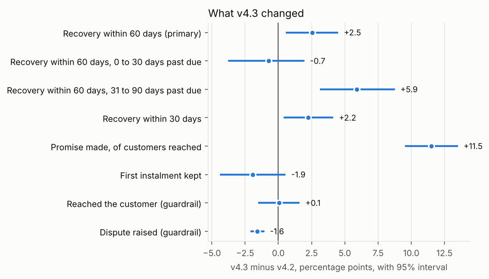

# Collections analytics

**[Open the dashboard](https://nishantrv333.github.io/Collections-Analytics/)** to see the results without running anything.

This project is the work a product data analyst does at a company running AI voice agents for banks' debt collection. It covers deciding what the KPIs are and making everyone calculate them the same way, building the data models behind them, invoicing every bank in its own currency, reading experiments on new agent versions properly, and chasing numbers that look off back to the cause.

It is built around four banks, with the UK and the UAE at the centre: Northgate Bank in London and Desert Finance in Dubai, alongside a Spanish bank and a Mexican fintech. Each market runs on its own currency, calendar, languages and calling rules.

Call level collections data tied to payments is never published, because it is personal financial data, so the platform data is simulated. Wherever real data exists, the project uses it:

* **Real ECB exchange rates** for every conversion and invoice.
* **Real 2026 public holidays** for each market.
* **Each market's calling rules:** the UAE's 09:00 to 20:00, and the FCA's "no unreasonable times" in the UK, turned into a stated policy.
* **Two real public datasets** that set how the simulated customers behave:
  * 41,188 bank calls, which set how fast each extra call loses its chance of working.
  * 30,000 card customers, which set how much less likely people further behind are to pay.

[docs/real_data.md](docs/real_data.md) lists exactly what is real and what is assumed.

Everything runs from one command in about a minute, and every number below comes out of the code.

## What I found

**The new agent should go live for older debt, in all four markets.** Agent v4.3 starts with the customer's situation before asking for money. It raised promises to pay by 11.5 points, which is the number everyone would have watched, but the money moved far less. Recovery within 60 days rose 2.5 points overall (p = 0.012). All of that came from accounts 31 to 90 days past due, which gained 5.9 points (p below 0.0001), and the gain was positive in the UK, the UAE, Spain and Mexico. Newer debt saw no change. Disputes nearly halved. Going live for the older group is worth about EUR 346,000 a month more collected for the banks. [Full write up](docs/experiment_agent_v43.md)



**The agent struggles in Hindi, and that is the UAE's whole gap.** Desert Finance's promise rate is 3.5 points below the UK's. Hindi conversations, 15% of the bank's customers, end in a promise 31% of the time against 45% in Arabic and English. They end in "call me back" 2.5 times as often and run longer, but refusals are no higher. That looks like speech recognition, not unwilling customers, and the gap holds at every debt age. Remove Hindi and the UAE matches the UK. [Product review](docs/product_review.md)

**Calls are going out at the wrong hours.** Raw numbers make mid afternoon look best, but only because first calls are scheduled then. Adjusted for that, 18:00 to 20:00 reaches about 30% more people than expected and gets under 5% of calls, while 13:00 to 15:00 gets nearly 20% of calls and is the weakest slot. Moving half of those calls into the evening is worth testing. It could mean roughly 5% more conversations from the same number of calls.

**The test's split was broken, and I caught it before reading results.** 7,914 accounts against 7,520 is not a fair 50/50 (p = 0.0015). Checking all 139 bank days showed that a deploy sent every one of Lumen's 373 new accounts to the old agent for four days in July. I left those days out and the split was fine again.

**We overbilled Banco Meridia by EUR 7,755.59.** Their 14 August payment file was loaded twice, which also made their August look 4.7% better than it was. The model now fixes it at the source, a check catches it from now on, and the September invoice credits it automatically. [Write up](docs/investigation_duplicate_payments.md)

**13% of all money collected was missing from the euro numbers.** ECB rates are only published on weekdays, the first version joined payments to rates by date, and every weekend payment silently dropped out. The UK and UAE books looked about a sixth smaller than they were. [Write up](docs/investigation_weekend_fx.md)

## What is in it

| The job | Where it is in this project |
|---|---|
| Own the numbers | [docs/metrics.md](docs/metrics.md) defines every KPI once, with the SQL file that calculates it. It also covers the two versions of "collected in September" that operations and finance both use, and why a UK bank holiday made them differ by GBP 174,317. |
| Build the source of truth | `sql/` has three layers of models (staging, intermediate, marts) built in DuckDB, plus a [dashboard](https://nishantrv333.github.io/Collections-Analytics/) on top. |
| Automate invoicing | `src/invoicing.py` invoices every bank for a month. It handles tiered success fees, usage, platform fees, minimums, contract changes, currency conversion at the ECB rate and corrections to earlier months. It refuses to write an invoice that does not tie back to the data. |
| Prove what works | `src/experiment.py` reads the v4.3 test. It runs a split check, an A/A test for sizing, stratified bootstrap intervals, guardrails, and the planned split by debt age with a check by market. |
| Product insight | `src/product_review.py` compares markets, languages, call numbers and calling hours, and turns each finding into a test or a fix with its size. |
| Get to the root cause | Two investigations in `docs/`, and 14 data checks in `sql/checks/` so the same problems cannot come back quietly. |

## Running it

You need Python 3.10 or newer.

```
pip install -r requirements.txt
python run_all.py
```

That runs these steps in order and stops at the first failure:

1. `src/get_real_data.py` downloads the real data into `data/real/` (already included, so this is skipped unless you delete it)
2. `src/analyse_real_data.py` analyses it and writes `config/calibration.json`
3. `src/generate_data.py` writes the simulated platform data to `data/raw/` (same seed, same data every time)
4. `src/build_models.py` builds the warehouse in `data/warehouse.duckdb` and exports the marts to `output/marts/`
5. `src/run_checks.py` runs the data checks
6. `src/invoicing.py --month 2026-09` writes the September invoices to `output/invoices/2026-09/`
7. `src/experiment.py` reads the v4.3 test
8. `src/product_review.py` builds the product review numbers
9. `src/investigations.py` reproduces the numbers in the two investigations
10. `src/export_dashboard.py` writes the small files the dashboard reads
11. `src/build_site.py` builds `index.html`, the dashboard as a page GitHub Pages can serve

## The four banks

| Bank | Market | Currency | Product | Calling rules | Why it is interesting |
|---|---|---|---|---|---|
| Northgate Bank | UK | GBP | Credit cards | 08:00 to 21:00, Monday to Saturday (policy; the FCA sets no hours) | Tiered fee: 12% on the first 100,000 a month, 9% above. Late summer bank holiday on 31 August. No WhatsApp. |
| Desert Finance | UAE | AED | Personal loans | 09:00 to 20:00, Monday to Friday (Central Bank rule; Saturday and Sunday weekend) | Arabic, English and Hindi. Islamic New Year and the Prophet's Birthday off. Platform fee plus success fee. |
| Banco Meridia | Spain | EUR | Consumer loans | 09:00 to 21:00, Monday to Saturday | Contract changed on 1 September (15% to 14%). Sends a payment file twice. |
| Lumen Pay | Mexico | MXN, invoiced in USD | Buy now pay later | 09:00 to 21:00, Monday to Saturday | Lots of weekend card and cash voucher payments. Broken experiment split for four days. |

Accounts are placed on business days from 1 June to 18 September 2026, and the data runs to 30 September. In total there are 35,250 accounts, 434,973 calls and messages, 11,846 promises to pay, and 23,335 payment rows from 344 bank files.

## How the models are built

```
raw CSVs  >  staging  >  intermediate  >  marts  >  dashboard, invoices, experiment, product review
```

**Staging** (`sql/staging/`) is one model per raw table. It sets types, names, and local dates in each bank's own time zone, with no business logic, so it is easy to trust.

**Intermediate** (`sql/intermediate/`) is where the rules live: one row per real bank transaction, an FX rate for every calendar day, whether each instalment was kept, and money in and out per account per day.

**Marts** (`sql/marts/`) are what people use: one row per account, the monthly KPIs per bank, recovery curves by placement month, the funnel, and what each bank is billed on.

Each SQL file is one table named after the file. `build_models.py` works out the build order from which models each file mentions, so adding a model is just adding a file. It is plain SQL and a short Python runner so anyone can read it, laid out the way dbt projects are, so it would move across easily.

## Invoicing

For each bank, for a month, `invoicing.py`:

* picks the contract in force, and refuses to guess if two contracts overlap one month
* charges the success fee on money in the bank's own files dated that month, net of reversals, with tiers where the contract has them
* adds voice minutes, messages and platform fees where the contract charges them
* tops up to the monthly minimum if the month comes in under it
* compares every earlier invoice with what the data says now, and adds a correction line for any difference
* converts once, at the end, into the invoice currency at the ECB rate on the last day of the month
* checks that the fee base equals the warehouse and the bank files, and that the lines add up, before writing anything

It writes a PDF per bank, a CSV of every line, and a CSV per bank listing every payment file behind the fee, so the bank can check it against its own records. September came out at EUR 500,619.75 across the four banks, before tax, including the EUR 7,755.59 credit to Meridia.

## Data checks

Each file in `sql/checks/` is a query that returns the rows breaking a rule, so no rows means it passed. An error stops the run; a warning prints and carries on. They cover:

* duplicate payments, and bank files loaded twice
* payments with no FX rate, and euro totals that do not convert back to the bank files
* reversals that do not match a payment
* collecting more than the balance
* contact before the account was placed
* calls outside each market's permitted hours, or on a public holiday
* instalments that do not add up to the promise
* accounts in two experiment arms, or called with the wrong agent version
* money lost between layers, and missing FX publications

## Where I used AI

I used Claude as a pair programmer on this, mostly for the data generator, the PDF layout and first drafts of SQL. That is also part of why the checks folder exists. Generated SQL is very good at producing a confident number that is quietly wrong, like the weekend FX join. The real protection is checks that compare totals across layers and back to the source, plus knowing the traps: the call duration column in the real bank data is the classic example of something an automated model will happily use and should not.

## What I would do next with real data

* Move the models to dbt and run them every morning after the bank files land, with the checks as tests that alert someone.
* Add cost per euro collected (telephony and model cost per call), the number that shows what the agent saves against a call centre or an agency.
* Run the three tests from the product review: the Hindi speech recognition check, WhatsApp after six calls, and evening calling.
* Recheck the v4.3 result at 90 days in October, and keep the 10% UAE holdout honest.
* Get the calling rules for each market confirmed by compliance and stored as data, not code.

## Folders

```
run_all.py                  runs everything
index.html                  the dashboard page served by GitHub Pages (built by run_all.py)
src/                        Python: real data, data generator, model builder, checks, invoicing, experiment, product review, investigations
sql/staging/                one model per raw table
sql/intermediate/           business rules
sql/marts/                  tables people use
sql/checks/                 data checks
config/calibration.json     the numbers the simulation takes from real data
docs/                       metric definitions, real data, the experiment, the product review and the two investigations
data/real/                  the real public data (included)
output/                     marts, invoices, experiment, product review, investigation numbers, dashboard
data/raw/, data/*.duckdb    simulated data and the warehouse (created by run_all.py, not committed)
```

Nishant Vatnal
