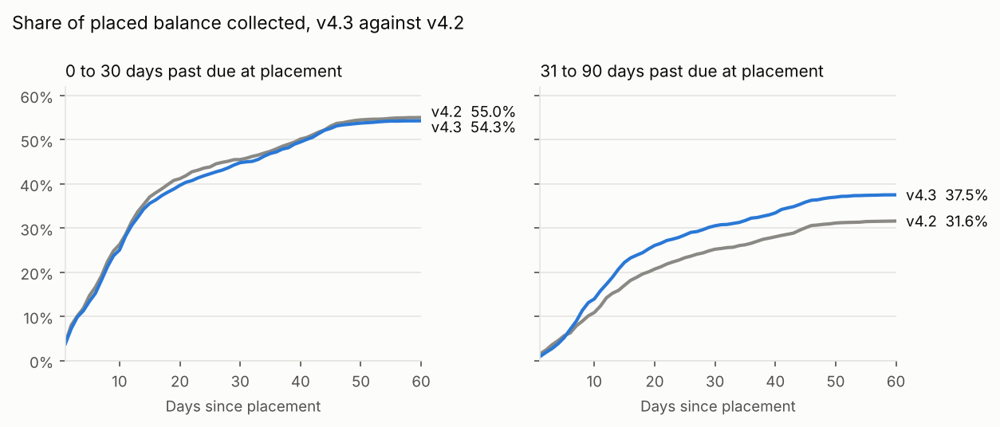

# Agent v4.3: should it go live?

**Short answer: yes, for accounts 31 to 90 days past due, in all four markets. Not yet for 0 to 30.** For the older debt, v4.3 collects 5.9 points more of the balance within 60 days, about EUR 346,000 more a month at current volumes, and it nearly halves disputes. For the newest debt it makes no measurable difference.

## What v4.3 changes

v4.2 asks for the full balance first and offers a plan only if the customer pushes back. v4.3 starts with the customer's situation (income, other debts, what they can manage) and offers a plan sized to that. The idea is that more people agree to something they can actually keep.

## How the test was set up

These were agreed before the test started, so the result could not be shaped after seeing the data.

* **Who:** every account placed from 15 June to 31 July 2026 at all four banks: Northgate (UK), Desert Finance (UAE), Banco Meridia (Spain) and Lumen Pay (Mexico). Each account was assigned 50/50 when it arrived. The account is the unit, so the same customer never heard both agents.
* **Primary metric:** share of the placed balance collected within 60 days, net of reversals. 60 days and not 30, because v4.3 offers more instalment plans and much of that money lands later. Balances and payments both in euros at the placement date rate, so currency moves cannot look like a lift.
* **Read it split by debt age too:** 0 to 30 days past due and 31 to 90 days past due. The agent is already set up differently for these two groups, so this split was planned, not something I went looking for.
* **Guardrails:** reach rate (v4.3 changes what the agent says, not who gets called, so this should not move) and dispute rate (should not go up).

**How big a lift could it see?** Before the test, I split the 4,521 accounts placed from 1 to 14 June in half at random 500 times and measured the 60 day recovery gap each time. With no real difference between the halves, the gap still moved by 1.9 points (standard deviation). Scaled up to the size of the test, the smallest lift it could reliably detect was about 2.9 points. Knowing that before reading the result stops me getting excited about a 1 point "lift".

## First, is the split clean?

No. 7,914 accounts went to v4.2 and 7,520 to v4.3. For a fair coin that gap has a p value of 0.0015, so something was wrong with the assignment.

I checked the split for every bank on every day: 139 bank days (`output/experiment/split_by_bank_and_day.csv`). With that many days, one will look uneven by chance, so a day only counts as broken below p = 0.05 / 139. Four days failed, all at Lumen: from 20 to 23 July, all 373 accounts went to v4.2 and none to v4.3. A deploy on Lumen's integration had pinned new accounts to the control version for four days.

Those 373 accounts were not randomised, so they cannot be compared with anything. I left them out. After that the split is 7,541 against 7,520, p = 0.86, which is fine.

## Results

All on 15,061 accounts. Intervals are 95%. The recovery numbers are compared inside each bank and debt age group and then combined, weighted by balance, which stops one arm looking better just because it happened to get more big balances or more old debt. Their intervals come from 2,000 bootstrap resamples. The v4.2 and v4.3 columns are the plain shares, so subtracting them can differ slightly from the like for like difference.

| | v4.2 | v4.3 | Difference | 95% interval |
|---|---:|---:|---:|---|
| **Recovery within 60 days (primary)** | 43.5% | 46.0% | **+2.5 pts** | 0.5 to 4.7 higher, p = 0.015 |
| Recovery within 30 days | 35.5% | 37.8% | +2.2 pts | 0.3 to 4.2 higher |
| Promise made, of customers reached | 52.0% | 63.5% | +11.5 pts | 9.5 to 13.5 higher |
| First instalment kept | 71.0% | 69.1% | 1.9 pts lower | 4.4 lower to 0.5 higher |
| Reached the customer (guardrail) | 61.4% | 61.4% | no change | 1.5 lower to 1.6 higher |
| Dispute raised (guardrail) | 3.5% | 1.9% | **1.6 pts lower** | 1.1 to 2.1 lower |

**The promise rate would have oversold it.** Promises jump by 11.5 points, and that was obvious within days. The money moved by 2.5 points. Promises are not cash: v4.3's plans spread payments over months, and its extra promises are kept slightly less often. Shipping on the promise rate would have set expectations more than four times too high.

**The guardrails are fine, and one is better.** Reach did not move, as expected. Disputes nearly halved, which makes sense: starting with the customer's situation gives them less to argue with. In the UK that matters beyond the money, because the FCA's Consumer Duty asks firms to show good outcomes for customers in financial difficulty.

### Split by debt age, as agreed

| | v4.2 | v4.3 | Difference | 95% interval |
|---|---:|---:|---:|---|
| 0 to 30 days past due | 55.0% | 54.3% | 0.7 pts lower | 3.5 lower to 2.0 higher, p = 0.61 |
| 31 to 90 days past due | 31.6% | 37.5% | **+5.9 pts** | 3.0 to 8.6 higher, p below 0.0001 |

With two planned groups I hold each one to p below 0.025 instead of 0.05. The older group clears that by a long way. All of the overall gain comes from it.

The curves show why. For older debt, v4.3 is ahead from about day 10 and the gap keeps growing as instalments land: 3.1 points at day 10, 5.3 at day 30, 5.9 at day 60. For the newest debt the two lines sit on top of each other, with v4.2 very slightly ahead. Those customers mostly pay anyway, and v4.2 gets a few more of them to pay in full on the call (22.3% of reached customers against 21.6%).

### Does it hold in each market?

This split was not agreed in advance and the test was not sized for it, so it is a consistency check, not a result. For older debt:

| Market | Accounts | v4.2 | v4.3 | Difference | 95% interval |
|---|---:|---:|---:|---:|---|
| UK, Northgate | 2,391 | 29.8% | 37.7% | +7.5 pts | 2.9 to 12.0 higher |
| Spain, Meridia | 1,678 | 32.2% | 38.1% | +6.1 pts | 0.7 to 11.5 higher |
| Mexico, Lumen | 1,520 | 34.8% | 38.7% | +4.5 pts | 1.4 lower to 10.2 higher |
| UAE, Desert | 1,870 | 33.2% | 36.9% | +4.0 pts | 0.9 lower to 8.9 higher |

Positive everywhere, and the intervals all overlap, so there is no sign it works in one market and not another. The UAE gain is the smallest. That fits with the product review, which found the agent struggles in Hindi: if one in seven conversations goes badly in either version, there is less for v4.3 to improve.

## What it is worth

Banks place about EUR 5.85 million of 31 to 90 day debt with us per month across the four banks (July and August average). 5.9 more points of that collected within 60 days is about **EUR 346,000 more for the banks per month**. At our success fees of 8% to 15%, that is roughly EUR 28,000 to 52,000 a month for us.

## Recommendation

1. **Go live with v4.3 for accounts 31 to 90 days past due, at all four banks.** In the UAE, keep 10% of those accounts on v4.2 for a month, because the gain there is the least certain. That gives a clean read in about four weeks.
2. **Keep v4.2 for 0 to 30 days past due.** Next test for that group: ask about affordability only after the customer says no to paying in full. That keeps the payments on the call and still catches the people who need a plan.
3. **Watch after launch:** the kept rate on second and later instalments. The test only sees 60 days and a six instalment plan runs for six months, so I would recheck the July cohort at 90 days in October.

## Reproducing this

`python src/experiment.py` rebuilds every number, table and chart above from the warehouse. Outputs are in `output/experiment/`.
