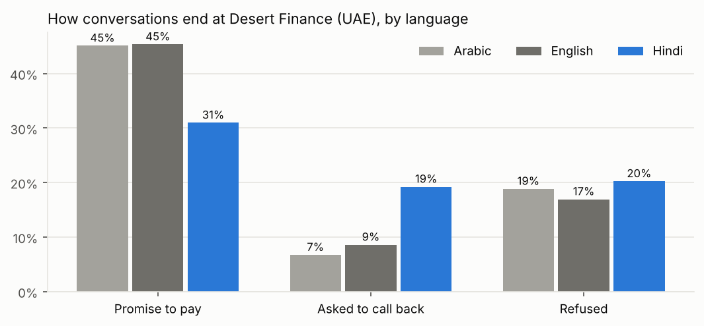
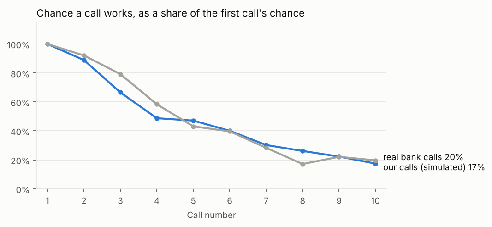

# Product review: where the agent is losing conversations

This is the review I would bring to the product team: how the agent is doing in each market, and three things to fix or test next, each with the size of the prize. It uses only accounts on the current agent (v4.2), so the v4.3 test does not blur anything. Every number comes from `python src/product_review.py`, with tables in `output/product/`.

## The four markets side by side

Accounts placed June to August, so each one has had at least 30 days.

| | UK, Northgate | UAE, Desert | Spain, Meridia | Mexico, Lumen |
|---|---:|---:|---:|---:|
| Accounts | 6,510 | 5,087 | 4,778 | 5,031 |
| Reached the customer | 60.8% | 63.2% | 64.5% | 56.3% |
| Calls to reach them | 3.6 | 3.5 | 3.5 | 3.6 |
| Promise rate, of conversations | 46.3% | **42.8%** | 45.5% | 46.7% |
| Paid on the call, of conversations | 16.6% | 17.0% | 17.0% | 17.5% |
| First instalment kept | 72.3% | 72.9% | 68.4% | 69.6% |
| Balance collected within 30 days | 35.0% | 35.4% | 35.2% | 36.6% |
| Disputes, of accounts | 3.4% | 3.3% | 4.1% | 2.9% |

The UK and the UAE look almost the same, except for one number: the UAE's promise rate is 3.5 points lower. That gap is the first finding.

## 1. The agent struggles in Hindi

Desert Finance's customers speak Arabic (50%), English (35%) and Hindi (15%), and the agent handles all three. Splitting its conversations by language:

| | Arabic | English | Hindi |
|---|---:|---:|---:|
| Conversations | 2,155 | 1,665 | 707 |
| Promise to pay | 45.1% | 45.4% | **31.0%** |
| Asked to call back | 6.7% | 8.6% | **19.2%** |
| Refused | 18.8% | 16.9% | 20.2% |
| Average conversation | 4.6 min | 4.5 min | **5.1 min** |

Hindi conversations end in a promise 14 points less often and in "call me back" 12 points more often. Both differences are far beyond chance (p below 0.0001). But Hindi speakers refuse no more often than anyone else (20.2% against 18.0%, p = 0.18), and their calls run half a minute longer.

That combination matters. If Hindi speaking customers were simply less willing to pay, refusals would go up. Instead, conversations stall and get pushed to later, and take longer while they do. That looks like the agent not understanding or not being understood, not like the customers.

I also checked it is not a mix effect, with Hindi speakers being further behind on their debt. The gap is there in every debt age group: promise rate 34% against 49% at 0 to 30 days, 30% against 42% at 31 to 60, and 21% against 36% at 61 to 90.

Take Hindi out and the UAE's promise rate is 45.2%, the same as English in the UK (45.4%). So this explains the whole UAE gap.

**What I would do:** pull 50 Hindi calls that ended in a callback and listen to them with someone who speaks Hindi, and check the speech recognition error rate for Hindi against Arabic and English. If it is the recognition, the fix is in the speech stack, not the script. Closing the gap would mean about 14 more promises for every 100 Hindi conversations.

## 2. Calls 7 to 12 cost a quarter of the minutes

The chance of reaching someone falls with every call: 17.4% on the first call, 7.0% on the sixth, 1.9% on the twelfth. The curve follows the real bank data closely (see [real_data.md](real_data.md)), which is a good sign the simulation behaves like real calling.

Calls 7 to 12 use 24.9% of all the voice minutes spent before reaching someone, and produce 14.9% of first conversations. That is not nothing: one in seven customers we reach, we reach after the sixth call. So I would not cap calls on this evidence alone.

**What I would test:** after six unanswered calls, switch to WhatsApp (or SMS in the UK) with a link to the payment portal, and call again only if the customer engages. Test it against the current schedule with recovery within 60 days as the primary metric, not conversations, because a WhatsApp payment is worth the same as one taken on a call.

## 3. The afternoon calls are in the wrong hours

The raw numbers say 16:00 is the best hour to call (10.9% reached). That is misleading: nearly a third of calls at 15:00 and 16:00 are first calls, which are scheduled for the afternoon of the day an account arrives, and first calls always work best. Comparing each hour with what its mix of call numbers would predict (above 1 is better than expected):

| Hour (local) | Share of calls | Reached against expected |
|---|---:|---:|
| 10:00 | 12.2% | 1.20 |
| 11:00 | 12.3% | 1.17 |
| 13:00 | 9.3% | **0.82** |
| 14:00 | 10.3% | **0.79** |
| 18:00 | 2.2% | **1.29** |
| 19:00 | 2.5% | **1.34** |

Early evening is the best time to reach people and gets under 5% of the calls. Early afternoon is the worst and gets nearly 20%.

**What I would test:** move half of the 13:00 to 15:00 calls to 18:00 to 20:00 (to 19:00 in the UAE, where calls must end by 20:00). If the pattern holds, that is roughly 5% more conversations from the same number of calls. It needs a test rather than a straight switch, because evening capacity and how customers feel about evening calls are both unknowns.

## Also worth a look

Lumen Pay has the lowest reach in the portfolio, 56% against 61% to 65% elsewhere, while needing about the same number of calls to reach someone once it does. The next thing I would check is the quality of the phone numbers in Lumen's placement files: how many fail as invalid on the first call, and how often skip tracing has to replace them.
