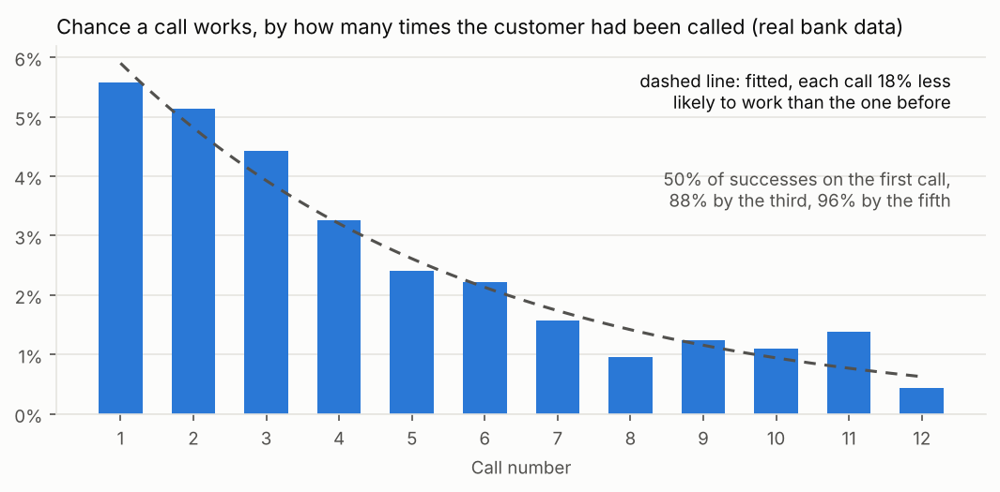
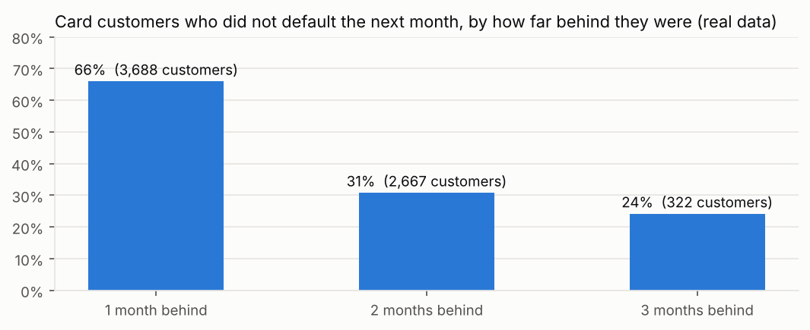

# What real data says, and what the simulation takes from it

No collections company publishes call level data tied to payments, because it is personal financial data. So the platform data in this project is simulated. But I did not want the simulation to be numbers I made up, so I grounded it in real public data wherever real data exists, and I list below exactly which parts are real and which are assumptions.

`python src/get_real_data.py` downloads everything here (from the official source, or a public GitHub copy if that is unreachable) and checks each file against the size the source publishes. `python src/analyse_real_data.py` produces every number on this page and writes `config/calibration.json`, which the simulation reads.

## Sources

| Data | What it is | Licence |
|---|---|---|
| UCI Bank Marketing, "bank additional full" | 41,188 real outbound calls by a Portuguese bank, May 2008 to November 2010, with how many times each customer was called and whether it worked. Moro, Cortez and Rita (2014), *Decision Support Systems* 62. | CC BY 4.0 |
| UCI Default of Credit Card Clients | 30,000 real card customers in Taiwan with six months of repayment status, April to September 2005. Yeh and Lien (2009), *Expert Systems with Applications* 36(2). | CC BY 4.0 |
| ECB euro reference rates | The official daily FX rates, used for every euro figure and every invoice. The ECB does not publish the UAE dirham, which is pegged to the US dollar at 3.6725, so AED comes from the USD rate. | Free reuse with source acknowledged |
| Public holidays, `holidays` Python package | Real 2026 calendars for England, the UAE, Spain and Mexico. UAE Islamic holidays follow the moon, so their dates are the published estimates. | MIT |

## Calls: each extra call is worth less

In the bank data, "campaign" is how many times a customer was called, and the last call is the one with the outcome. So for any call number k, I can work out the chance that call k worked, out of customers who got at least k calls (`output/real_data/call_attempts.csv`).

* The first call worked 5.6% of the time. The fourth, 3.3%. The eighth, 1.0%.
* Half of all successes came on the first call, 88% by the third and 96% by the fifth.
* Fitted over calls 1 to 10, **each call is about 18% less likely to work than the one before** (a factor of 0.816).

**Used in the simulation:** the chance of reaching a customer drops by that same factor with every call. The product review checks the result: in the simulated platform, call 10 works 17% as often as call 1; in the real bank data, 20%.

## Two traps in the call data

These are the mistakes a quick analysis, or an AI tool asked to "find what drives success", makes with this data.

**Mobile looks almost three times better than landline. It is closer to twice, and not every month.** Mobile calls worked 14.7% of the time against 5.2% for landlines, 2.8 times as often. But most landline calls were made in May and June 2008, when everything worked badly. Compared inside each month, the gap is 1.9 times, and in three of the seven months with enough calls of both kinds (April, August and November) landlines did better (`mobile_vs_landline_by_month.csv`).

The month itself is a bigger trap. March, September, October and December show 44% to 51% success, against 6% in May. Those were the months with the fewest calls (182 to 718 against 13,769 in May), so they were almost certainly smaller, better targeted campaigns, not better months. Reading this as "call in September" would be wrong.

**Call duration predicts the outcome almost perfectly, and is useless.** A model that includes how long the call lasted scores 0.94 (AUC). Without it, 0.79. But you only know the duration after the call, so it cannot help decide who to call. The dataset's own description warns about this, and it is exactly the kind of column an automated model will happily use. Any model for choosing who to call has to be built only from what is known before dialling.

Two more things worth knowing: customers who said yes to a previous campaign said yes again 65% of the time, against 14% for those who said no last time and 9% for those never called before, so past behaviour is the strongest signal there is. Day of the week matters a little: about 10% on Mondays against 12% on Thursdays.

## Repayment: the further behind, the less likely to pay

Customers one month behind in September did not default the next month 66% of the time. Two months behind, 31%. Three months behind, 24%.

**Used in the simulation:** customers 31 to 60 days past due pay on their own at 0.47 times the rate of customers 0 to 30 days past due, and 61 to 90 days at 0.37 times, the same ratios as the real data.

### A data quality problem in this dataset

"One month behind" almost does not exist before September:

| Month | One month behind | Two months behind |
|---|---:|---:|
| April | 0 | 2,766 |
| May | 0 | 2,626 |
| June | 2 | 3,159 |
| July | 4 | 3,819 |
| August | 28 | 3,927 |
| September | 3,688 | 2,667 |

Nobody can be two months behind in May without first being one month behind. This looks like the status was coded differently in the earlier months, not like real behaviour. So I used only September for "one month behind" and did not build any month to month roll rates that start from it. The dataset's description also never defines the codes -2 and 0, which are common in the data.

From the months that are usable: of customers two months behind in August, 10% were fully up to date in September, 43% had caught up to one month behind, 41% stayed two months behind, and 7% fell further.

## What is real and what is assumed

| In the simulation | Source |
|---|---|
| How fast each extra call loses its chance of working | Real: bank calls |
| How much less likely customers further behind are to pay on their own | Real: card repayment |
| FX rates for every conversion and invoice | Real: ECB |
| Public holidays, and so which days have no calls and no bank files | Real: 2026 calendars |
| UAE calling hours, 09:00 to 20:00, Monday to Friday | The hours are the Central Bank of the UAE's rule (Consumer Protection rulebook, section 5.2.5, as summarised by [LY Lawyers](https://lylawyers.com/debt-collection-regulations-in-the-uae/)). Weekdays only is our policy, since the UAE weekend is Saturday and Sunday. |
| UK calling hours, 08:00 to 21:00, Monday to Saturday | Policy. The FCA sets no hours, only that firms must not contact customers at unreasonable times ([CONC 7.3.10](https://handbook.fca.org.uk/handbook/conc7)). In a real job this comes from compliance. |
| Overall reach rate, promise rates, how often promises are kept, reversal rates, balances | Assumptions, set to sensible levels for early stage collections |
| The v4.3 effect, the Hindi problem, the resent bank file, the broken experiment split | Put in on purpose, so the analysis has real problems to find |
